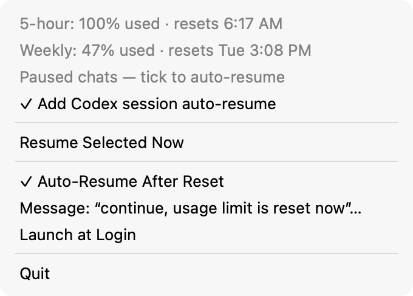

# Codex Resumer

A tiny macOS menu-bar app that continues your Codex chats automatically once a usage limit (5-hour or weekly) resets.



## Features

- **Auto-resume after reset**: finds Codex chats whose last turn stopped with *"You've hit your usage limit"*, waits until the limit actually resets, then opens each chat and sends your message (default `continue`).
- **Handles both windows**: if the 5-hour and weekly limits are both exhausted, it waits for the later of the two resets.
- **Live usage in the menu**: 5-hour and weekly usage with their reset times, read from Codex's own `account/rateLimits/read` API.
- **Pick which chats resume**: every paused chat is ticked by default. Click one to untick it and it is skipped; your choice is remembered. Hold **⌥ Option** to swap each row for *Open in Codex*. **Resume Selected Now** sends the message straight away, which is useful after spending a reset credit.
- **Editable message**, **Launch at Login**, and an on/off toggle.
- **Lightweight**: one AppKit binary with no SwiftUI and no web views, about 12 MB footprint (CodexReset measured 37 MB on the same machine). The 60 s check is a single read-only SQLite query of about 4 ms. `codex` itself runs only briefly, when a chat is paused or when you open the menu.
- **Safe by design**: it never redeems rate-limit reset credits, never edits Codex's config, and opens Codex's databases read-only.

## Requirements

- macOS 13 or later (universal binary: Apple silicon and Intel)
- The Codex desktop app (bundled in `/Applications/ChatGPT.app`) or the standalone `Codex.app`
- To build: Xcode Command Line Tools (`swiftc`)

## Install

### Option 1: DMG

1. Run `./package.sh` (or take a DMG from a release) and open `release/CodexResumer-<version>.dmg`.
2. Drag **Codex Resumer** to **Applications** and launch it.

### Option 2: Build from source

```bash
./build.sh            # debug build
./build.sh release    # optimized build
open "$HOME/Library/Caches/CodexResumerBuild/Codex Resumer.app"
```

### Option 3: Build and package a DMG

```bash
./package.sh          # → release/CodexResumer-<version>.dmg
```

## Permissions

| Permission | Why | How |
|---|---|---|
| Accessibility | Types the resume message into the Codex window and presses Return | Menu → **Grant Accessibility Access…**, or System Settings → Privacy & Security → Accessibility → enable **Codex Resumer** |

The app is ad-hoc signed, so macOS ties the Accessibility grant to that exact build. After rebuilding, remove the old entry and turn it on again.

## Usage

| Menu item | What it does |
|---|---|
| 5-hour / Weekly | Current usage and when each window resets |
| Paused chats (✓) | Chats stopped by a limit. Click to tick or untick for auto-resume. Hold ⌥ and click to open the chat in Codex |
| Resume Selected Now | Send the message to every ticked chat immediately |
| Auto-Resume After Reset | Turn automatic resuming on or off |
| Message… | Change the text that gets sent (default `continue`) |
| Launch at Login | Start with macOS |

The menu-bar icon is `↻` when nothing is waiting and `⏸` while ticked chats are waiting. Hover over it to see the resume time.

Diagnostics:

```bash
"/Applications/Codex Resumer.app/Contents/MacOS/CodexResumer" --dump
```

This prints usage, the computed resume time, the paused chats (✓ = will auto-resume) and the Accessibility state.

## How it works

1. **Detect** (every 60 s, and on wake): a read-only query on `~/.codex/thread_history_1.sqlite` finds threads whose most recent turn has `status = 'failed'` and `codexErrorInfo = usageLimitExceeded` (within the last 8 days, not archived). Titles come from `~/.codex/state_5.sqlite`.
2. **Schedule**: while something is paused, it starts `codex app-server` for about 2 s and calls `account/rateLimits/read`. Every window at 100% has a `resetsAt`, and the resume time is the latest of those plus 20 s. There is no other timer: the 60 s tick compares wall-clock time, so sleep and wake need no special handling.
3. **Confirm and resume**: at the resume time it reads usage again. If it is still limited, it reschedules. Otherwise, for each paused chat it opens `codex://threads/<id>`, waits for Codex to come to the front, focuses the composer through the accessibility tree, types the message and presses Return. Every keystroke first checks that Codex is still the frontmost app, so text never lands in another app. Afterwards it switches back to the app you were using.

**Why GUI typing rather than an API call?** The desktop app runs its app-server over stdio, so no other process can connect to it. Every open chat also holds a writer lock in `~/.codex/thread-writer-locks/`, so a second `codex app-server` that tries to resume the thread fails with *"already has an active writer"*. Typing into the app is the one way to continue a chat that the desktop app is showing.

### Known limitations

- Resuming brings Codex to the front for a few seconds per chat. If you are typing at that moment, focus moves.
- Chats running in the **terminal** Codex CLI (TUI) are listed but can't be typed into. Resume those yourself.
- Each failed turn gets at most 3 attempts, and each chat at most one automatic nudge every 15 minutes, so an unexpected limit can't cause a resume loop.
- This relies on Codex's local file layout (`thread_history_1.sqlite`, `state_5.sqlite`) and the `codex://threads/` link, which could change in a future Codex update.

## Project layout

```
codex-resumer/
├── Sources/main.swift        # the whole app (~600 lines)
├── Resources/Info.plist      # LSUIElement menu-bar app
├── docs/screenshots/menu.png # rendered with --snapshot
├── build.sh                  # universal build + ad-hoc sign
├── package.sh                # release build → DMG in release/
└── README.md
```

## License

Copyright © 2026 Manik Pruthi. All rights reserved.
